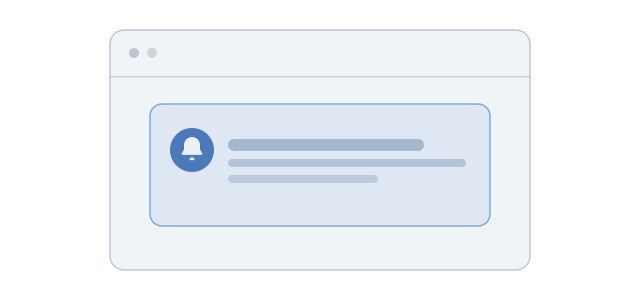

# dsh-task-notify

一轮对话结束时弹出系统通知：会话名、用时、token 用量，以及最后一条回复的预览。

Desktop notifications for finished DeepSeek Harness turns, with the conversation name, duration, token usage, and a short preview of the latest reply.

[中文](#中文) · [English](#english) · [Dev notes](#dev-notes) · [License](#license)



---

## 中文

### 它做什么

- 某轮对话结束（`turn/end`）时发送一条系统通知。
- 通知内容：
  - 标题：**任务完成** / **任务失败** / **任务已中止**
  - 正文：`会话名 · 用时 · 输入 375 · 输出 975 · 缓存 994k`
  - 第三行：最后一条回复的简短预览（可用 `previewChars: 0` 关闭）
- 平台：
  - **Windows**：以 DeepSeek Harness 的身份发出 Windows 通知（在系统通知中心可见），失败时回退为托盘气泡
  - **macOS**：`osascript` 通知横幅
  - **Linux**：`notify-send`
- 默认过滤：只通知主会话（子代理跳过）、短于 3 秒的回合跳过、用户主动中止不通知。
- 输入框输入 `/notify-test` 可发一条测试通知，并如实报告发送结果。

### 环境要求

- DeepSeek Harness 0.2.x（Desktop，或带 profile 的 CLI 启动）
- 实测环境：DSH 0.2.2-rc.3 / Windows 11 / Electron 44

### 安装

**方式一：本地目录（无需发布）**

```sh
git clone https://github.com/cool403/dsh-task-notify.git
```

然后 **插件（Plugins）→ 添加插件** 选择该目录；或让 agent 执行 `plugin_manager` 的 `install_bundle`，`target` 传该目录的绝对路径。

安装后在插件页确认出现 `task-notify` 行且为启用状态。卸载：`plugin_manager` 的 `remove_bundle`，`target` 用 `@cool403/dsh-task-notify`。

**方式二：直接从 Git 安装**

让 agent 执行 `plugin_manager` 的 `install_bundle`，`target` 传：

```
git+https://github.com/cool403/dsh-task-notify.git
```

（Git 规格安装机制已用本地仓库的 `git+file://` 验证通过；从 GitHub 拉取需要网络与公开仓库。）

**方式三：npm**

```sh
npm publish --access public
```

之后 `install_bundle` 的 `target` 直接用 `@cool403/dsh-task-notify`。

### 配置

插件没有设置表单（刻意保持零依赖），配置改在所属 profile 的 `cordis.patch.yml`（`~/.dsh/profiles/<profile>/cordis.patch.yml`）。按 id 覆盖一行即可，未写的字段沿用内置默认值：

```yaml
- id: task-notify
  name: "@cool403/dsh-task-notify"
  config:
    minDurationMs: 8000       # 只通知超过 8 秒的回合
    previewChars: 80          # 预览长度，0 关闭
    windowsChannel: balloon   # 看不到系统通知时改用托盘气泡
```

| 配置 | 默认 | 说明 |
|---|---|---|
| `enabled` | `true` | 关闭后不注册监听，也不再响应 `/notify-test` |
| `notifyOnCompleted` | `true` | 正常完成的回合 |
| `notifyOnError` | `true` | 模型或工具报错的回合 |
| `notifyOnAborted` | `false` | 主动中止、中断、阻塞的回合 |
| `minDurationMs` | `3000` | 短于该时长的回合不通知 |
| `includeSubagents` | `false` | 是否也通知子代理会话 |
| `previewChars` | `120` | 预览字符数，`0` 关闭预览 |
| `silent` | `false` | Windows 通知是否静音 |
| `titleCompleted` / `titleError` / `titleAborted` | 任务完成 / 任务失败 / 任务已中止 | 三种标题文案 |
| `bodyTemplate` | `{session} · {duration} · {tokens}` | 支持 `{session}` `{duration}` `{reason}` `{tokens}`；删掉 `{tokens}` 即不显示 token |
| `windowsAppId` | `com.deepseek.dsh` | 通知归属的 AppUserModelID；留空则强制走托盘气泡 |
| `windowsChannel` | `auto` | `auto`（先系统通知，失败回退气泡）/ `toast` / `balloon` |

### 看不到通知？

1. 先在输入框执行 `/notify-test`，看它报成功还是失败。
2. 报成功但没看到：到 Windows「设置 → 系统 → 通知」里允许 DeepSeek Harness 的横幅；或把 `windowsChannel` 改成 `balloon`。
3. 按 `Win + N` 打开通知中心，历史通知可能只是没有弹出横幅。

### 已知限制

- 无法判断窗口是否在前台，因此每个符合条件的回合都会通知。
- token 用量与用时在回合结束时从会话日志读取（该回合各次模型响应的 `usage` 累加，含缓存读取），因此插件即使在回合中途被重载，也不会丢统计。
- 仅在 Windows 11 + DSH Desktop 实测；macOS / Linux 用的是系统自带命令，未实测。
- 通知被系统彻底抑制时，通知 API 仍返回成功，插件无法区分「已发送」与「被系统拦截」，此时请用托盘气泡或检查系统设置。

---

## English

### What it does

- Sends one OS notification when a chat turn ends.
- The notification shows:
  - a title: **Task done** / **Task failed** / **Task aborted**
  - a body: `conversation · duration · in 375 · out 975 · cache 994k`
  - a third line: a short preview of the latest reply (disable with `previewChars: 0`)
- Platforms:
  - **Windows**: a real Windows toast under the DeepSeek Harness identity (visible in the Action Center), falling back to a tray balloon
  - **macOS**: notification banner through `osascript`
  - **Linux**: `notify-send`
- Defaults: interactive sessions only (subagent children are skipped), turns shorter than 3 s are skipped, user aborts do not notify.
- `/notify-test` sends a test notification and reports the actual delivery result.

### Requirements

- DeepSeek Harness 0.2.x (Desktop, or a CLI launch with a profile)
- Verified on DSH 0.2.2-rc.3, Windows 11, Electron 44

### Install

**Local directory (no publishing needed)**

```sh
git clone https://github.com/cool403/dsh-task-notify.git
```

Then use **Plugins → Add plugin** and pick that directory, or call `plugin_manager`'s `install_bundle` with the absolute directory as `target`.

Confirm the `task-notify` row appears and is enabled. Remove it with `remove_bundle` and target `@cool403/dsh-task-notify`.

**Directly from Git**

Call `plugin_manager`'s `install_bundle` with this target:

```
git+https://github.com/cool403/dsh-task-notify.git
```

(Git-spec installation was verified with a local `git+file://` repository; fetching from GitHub additionally needs network access to the public repository.)

**From npm**

```sh
npm publish --access public
```

Then install with `install_bundle` and target `@cool403/dsh-task-notify`.

### Configuration

There is no settings form (the plugin stays dependency-free). Override the Loader row in your profile's `cordis.patch.yml`; omitted fields keep their built-in defaults:

```yaml
- id: task-notify
  name: "@cool403/dsh-task-notify"
  config:
    minDurationMs: 8000
    previewChars: 80
    windowsChannel: balloon
```

The configuration table lives in the Chinese section above. `bodyTemplate` supports `{session}`, `{duration}`, `{reason}`, and `{tokens}`; drop `{tokens}` to hide token usage.

### Troubleshooting

Run `/notify-test` first. If it reports success but nothing appears, allow DeepSeek Harness under Windows Settings → System → Notifications, or set `windowsChannel: balloon`. Notifications may also sit in the Action Center (`Win + N`) without a banner.

### Limitations

Focus is not detectable, so every qualifying turn notifies. Duration and token usage are read from the session log when the turn ends (each model response's `usage`, including cache reads), so a mid-turn plugin reload does not lose them. Only Windows 11 + DSH Desktop was tested — the macOS and Linux channels use system commands and were not exercised. A notification suppressed by the OS still reports success, because the notification API has no "was it shown" signal.

---

## Dev notes

- The plugin is a Host-only bundle. It reads the post-commit `session/event` feed (`turn/start`, `assistant/message`, `turn/end`) and never appends session events; the session log stays the only source of truth.
- Duration, token usage, and the reply preview are read back from the session log's turn window (`turn/start` → `turn/end`) when the turn ends, so a reload in the middle of a turn still reports complete numbers. Token usage sums each `assistant/message` event's `usage` (`inputTokens`, `outputTokens`, `cacheReadTokens`, `cacheWriteTokens`) and renders compactly (`999`, `1.2k`, `12k`, `1.2M`).
- Notifications are delivered by spawning a helper (`powershell.exe`, `osascript`, or `notify-send`) and waiting for its exit code, so `/notify-test` reports a real result instead of an assumption.
- **Do not spawn the notification helper detached.** A detached Windows child can call `ToastNotificationManager.Show()`, exit `0`, and still have Windows silently discard the toast. The same program started in the parent's process group displays and records it. This plugin was diagnosed with exactly that failure mode, which is why `spawn` is called without `detached`.
- The Windows toast uses the Desktop app's AppUserModelID (`com.deepseek.dsh`) and falls back to a tray balloon when the toast API rejects the caller (for example from a sandboxed process).

## License

MIT © cool403
